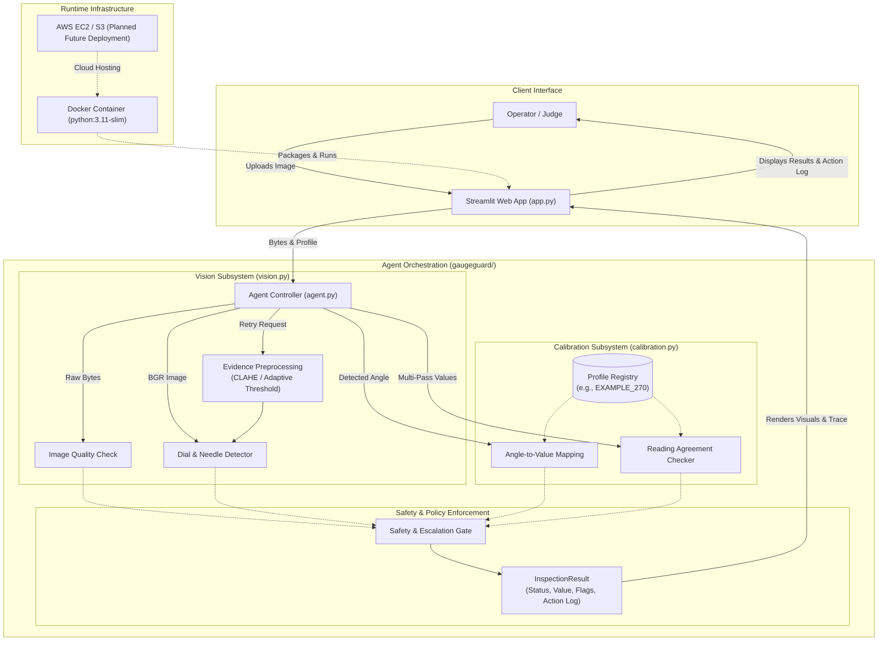

# GaugeGuard Agent: A Self-Verifying Agentic Vision System for Industrial Gauge Inspection

> **IMPORTANT SAFETY NOTICE:** GaugeGuard Agent is an experimental engineering prototype and is **not a certified measuring instrument**. It must never be used to operate machinery, control process loops, or make safety-critical decisions. All physical gauge readings require independent verification by a qualified human operator.

---

## 1. Project Title and Overview

**GaugeGuard Agent** is a transparent, self-verifying computer vision inspection system designed to read and monitor analog industrial dial gauges. Built with Python 3.11, OpenCV 5, and Streamlit, GaugeGuard replaces fragile single-shot computer vision pipelines with an **evidence-driven agentic inspection loop**.

Rather than returning silent errors or ungrounded readings when an image is blurred, poorly lit, or ambiguous, GaugeGuard:
1. Assesses image quality before running detection.
2. Localizes the circular dial and extracts needle vector geometry using classical computer vision.
3. Automatically triggers targeted preprocessing passes (such as CLAHE or adaptive thresholding) when first-pass visual evidence is uncertain.
4. Corroborates multi-pass readings against physical profile tolerances.
5. Gates readings against calibration bounds and strictly escalates unverified demonstration profiles (such as `EXAMPLE_270`) or out-of-spec conditions to human technicians.
6. Emits a comprehensive, auditable execution trace of every intermediate decision.

---

## 2. Problem Statement

Analog circular dial gauges (measuring pressure, temperature, vacuum, and flow) remain ubiquitous across chemical plants, manufacturing facilities, power stations, and boiler rooms because they operate purely mechanically without external electrical power. 

However, monitoring these gauges presents significant operational challenges:
- **Labor-Intensive Manual Rounds:** Human technicians must walk expansive facilities to log readings manually, introducing high labor costs and transcription errors.
- **Physical Safety Hazards:** Gauges are frequently located in hazardous, high-temperature, pressurized, or hard-to-reach environments.
- **Silent Failures in Traditional Computer Vision:** Standard automated vision systems and black-box neural networks often fail silently. Glare, motion blur, tilted viewing angles, or needle shadows can cause an algorithm to report a confident yet completely incorrect reading without warning.
- **Mismatched Calibration Profiles:** When vision systems lack formal calibration bounds, an unverified scale profile can report an incorrect physical value that automated systems blindly accept.

Industrial facilities require an inspection system that **knows what it does not know**—one that actively tests its own visual hypotheses, records an audit trace, and escalates to human review whenever certainty cannot be established.

---

## 3. Objectives

The primary objectives of the GaugeGuard Agent project are:
1. **Deterministic Geometric Vision:** Implement dial boundary localization and needle vector estimation using transparent, explainable OpenCV 5 geometric algorithms rather than uninterpretable black-box models.
2. **Quality-Gated Ingestion:** Evaluate input blur, contrast, and resolution prior to needle detection to prevent garbage-in/garbage-out processing.
3. **Evidence-Driven Retries:** Implement an agentic feedback loop where specific first-pass visual failure signals (e.g., low contrast, low confidence) select targeted secondary preprocessing methods.
4. **Dual-Pass Corroboration:** Cross-verify multi-pass detections using quantitative agreement checks before adopting an angular reading.
5. **Safety-First Calibration Gating:** Convert needle angles into calibrated engineering units while enforcing operating limits, scale boundaries, and mandatory human review for unverified demonstration profiles.
6. **Transparent Audit Logging:** Generate an immutable step-by-step trace of every tool, parameter, quality flag, and decision rationale for operator verification.

---

## 4. Key Features

### Gauge Image Upload and Visual Inspection
- Interactive web interface powered by Streamlit.
- Supports standard industrial image formats (`.jpg`, `.jpeg`, `.png`) up to 25 MB.
- Provides immediate side-by-side visual comparison between the raw uploaded photo and the analyzed image displaying dial center, boundary circle, needle vector ray, and detected tip coordinates.

### OpenCV-Based Dial and Needle Detection
- Employs **Hough Circle Transform** (`cv2.HoughCircles`) to locate circular dial outer boundaries and center pivots.
- Utilizes **Probabilistic Hough Line Transform** (`cv2.HoughLinesP`) on dial region-of-interest (ROI) Canny edge maps to detect candidate needle segments.
- Groups lines using angular vector clustering and radial length weighting.
- Implements collinear counterweight tail disambiguation (ignoring $180^\circ \pm 25^\circ$ counterweight rays) while preserving ambiguity detection for genuine multi-needle or pointer conflicts.

### Image Quality Assessment
- Analyzes grayscale images prior to detection.
- Computes **Laplacian Variance** as a blur indicator (flagging `possible_blur` if score $< 45.0$).
- Computes **Grayscale Standard Deviation** as a contrast indicator (flagging `low_contrast` if score $< 18.0$).
- Validates dimensional resolution (flagging `low_resolution` if minimum dimension $< 160\text{ px}$).

### Evidence-Driven Preprocessing and Retry Workflow
- When initial detection is unsuccessful, yields low confidence ($< 0.65$), or indicates low contrast, the agent automatically initiates up to two retry passes.
- Dynamically selects preprocessing based on visual evidence:
  - **CLAHE (Contrast Limited Adaptive Histogram Equalization):** Selected when low contrast or marginal confidence is detected.
  - **Gaussian Adaptive Binary Thresholding:** Selected when structural dial geometry fails to segment under standard edge detection.
- Evaluates multi-pass agreement (`readings_agree()`) against profile-defined fractional tolerance. If initial and retry readings disagree, the agent immediately escalates to human review.

### Gauge Calibration and Provisional Reading Calculation
- Converts needle angle to physical units using linear interpolation:
  $$\text{Value} = \text{Min Value} + \left(\frac{\text{Angle} - \text{Min Angle}}{\text{Max Angle} - \text{Min Angle}}\right) \times (\text{Max Value} - \text{Min Value})$$
- Supports clockwise needle sweeps with angular wrap-around handling across the $0^\circ$ (12 o'clock) boundary.
- Evaluates bounds margins and safe operating limits (`operating_min`, `operating_max`).

### Human-Review Escalation for Ambiguous or Unverified Results
- Strict escalation policy: An inspection **cannot** be marked `Accepted` if:
  - The active calibration profile is an unverified demonstration profile (e.g., `EXAMPLE_270` with placeholder unit `"units"`).
  - The needle direction is ambiguous (`ambiguous_needle`).
  - Detection passes disagree across retries.
  - Calculated values fall outside calibrated scale limits or operating thresholds.
  - Image quality checks fail.
- When human review is required, the calculated value is **preserved as provisional** rather than discarded, giving operators an indicative reading alongside the required verification warning.

### Inspection Activity Trace and Diagnostic Information
- Every run populates an auditable sequence of `AgentStep` records:
  - Step 1: `quality_check` (Laplacian variance, contrast std, resolution)
  - Step 2: `initial_detection` (dial center, radius, needle angle, confidence, method flags)
  - Step 3 (Conditional): `retry_1_<method>` / `retry_2_<method>` (telemetry and rationale)
  - Step 4 (Conditional): `reading_comparison` (initial vs. retry delta, tolerance, agreement result)
  - Step 5: `calibration_mapping` (profile name, angular mapping, bounds checks, active flags)
  - Step 6: `final_decision` (operating decision, status, active flags, plain-English rationale)
- Detailed JSON payloads for each step are viewable directly in expandable cards within the dashboard.

---

## 5. How the Agentic Vision Workflow Works

The end-to-end agentic workflow executes deterministically as follows:

```
[Raw Gauge Image]
        │
        ▼
[1. Decode & Quality Assessment] ──► (Compute blur, contrast, resolution)
        │
        ▼
[2. First-Pass Vision Detection] ──► (Hough circles, Canny edges, Hough lines, vector clustering)
        │
        ├─► Confident, Clear Detection ───────────────────────────┐
        │                                                         │
        └─► Detection Uncertain / Low Confidence / Low Contrast   │
                    │                                             │
                    ▼                                             │
        [3. Evidence-Driven Retry Loop]                           │
            ├─► Low Contrast ──► Apply CLAHE                      │
            └─► Dial Failure ──► Apply Adaptive Threshold         │
                    │                                             │
                    ▼                                             │
        [4. Dual-Pass Corroboration]                              │
            ├─► Readings Disagree ──► Escalate to Human Review    │
            └─► Readings Agree    ──► Select Best Detection ──────┤
                                                                  │
                                                                  ▼
                                                      [5. Calibration Mapping]
                                                      (Map angle to engineering value)
                                                                  │
                                                                  ▼
                                                      [6. Safety Gating & Decision]
                                                      ├─ Unverified Profile? ──► Needs Human Review (Provisional)
                                                      ├─ Out of Bounds?      ──► Needs Human Review
                                                      ├─ Quality Flagged?    ──► Needs Human Review
                                                      └─ Fully Verified?     ──► Accepted
```

---

## 6. System Architecture

The following diagram illustrates the component architecture and data flow:



---

## 7. Technology Stack

GaugeGuard is engineered with a lean, auditable, and reproducible Python stack:

| Component | Technology | Version / Pinned Constraint | Purpose |
|---|---|---|---|
| **Runtime Language** | Python | `3.11.9` (Compatible with Python 3.11+) | Core application runtime |
| **Computer Vision** | OpenCV 5 (Headless) | `opencv-python-headless==5.0.0.93` | Dial circle detection, line extraction, image transformations |
| **Numeric Processing** | NumPy | `numpy>=2.0,<3` (Tested with NumPy 2.x) | Matrix math, trigonometric vector calculations, histogram arrays |
| **Application UI** | Streamlit | `streamlit>=1.60,<2` (Tested with Streamlit 1.66.0) | Interactive operator dashboard and execution trace viewer |
| **Test Framework** | pytest | `pytest>=8.0` (Tested with pytest 8.3.4) | Automated unit, integration, and safety regression testing |
| **Containerization** | Docker | Linux `python:3.11-slim` base image | Headless container deployment with `libglib2.0-0` and `libgomp1` |

> **Note on Artificial Intelligence:** GaugeGuard uses **classical, deterministic computer vision** and rule-based agentic orchestration (Hough transforms, Canny edge detection, angular vector clustering, CLAHE, and adaptive thresholding). It **does not rely on a trained neural network, opaque deep learning model, or generative AI** for vision detection, ensuring that every coordinate and angle is physically explainable and mathematically verifiable.

---

## 8. Project Directory Structure

The repository is organized cleanly into modular packages:

```text
GaugeGuard-Agent/
├── .dockerignore                 # Excluded files for clean Docker image builds
├── .gitignore                    # Git version control ignore rules
├── .streamlit/
│   └── config.toml               # Streamlit server and browser configuration (headless, port 8501)
├── Dockerfile                    # Production container specification (Python 3.11 slim)
├── LICENSE-NOTE.md               # Team notice on licensing and asset rights
├── README.md                     # Comprehensive project documentation (this document)
├── app.py                        # Streamlit dashboard and user interface
├── requirements.txt              # Pinned production runtime dependencies
├── requirements-dev.txt          # Development and testing dependencies (pytest)
├── data/
│   └── samples/
│       └── README.md             # Guidelines for licensed/consented sample images
├── docs/
│   ├── architecture.mmd          # Standalone Mermaid architecture diagram
│   ├── evaluation-plan.md        # Technical evaluation methodology and metrics
│   └── report-outline.md         # Engineering report outline
├── gaugeguard/                   # Core GaugeGuard Agent Python package
│   ├── __init__.py               # Package initializer
│   ├── agent.py                  # Agent orchestration, retry controller, and escalation gating
│   ├── calibration.py            # Angular-to-value mapping, profile validation, and agreement checks
│   ├── models.py                 # Shared immutable dataclasses (ImageQuality, ReadingEstimate, etc.)
│   └── vision.py                 # OpenCV 5 dial/needle detection, quality checks, and preprocessing
└── tests/                        # Automated test suite
    ├── __init__.py               # Test package initializer
    ├── fixtures/
    │   └── industrial_gauge.png  # Real-world industrial gauge test fixture
    ├── test_agent.py             # Agent orchestration and safety regression tests (19 tests)
    ├── test_calibration.py       # Calibration math, profile validation, and limit tests (84 tests)
    └── test_vision.py            # Dial localization, needle detection, and ambiguity tests (13 tests)
```

---

## 9. Prerequisites

Before installing GaugeGuard Agent locally, ensure the following are installed:
- **Operating System:** Windows 10/11, macOS, or Linux.
- **Python:** Version 3.11.x (verified on Python 3.11.9).
- **Git:** Version 2.30 or newer.
- **Docker Desktop:** (Optional, required for containerized execution) configured for Linux containers.
- **PowerShell:** Version 5.1 or PowerShell 7+ on Windows.

---

## 10. Local Installation and Setup

Follow these steps to set up the development environment on Windows using PowerShell:

```powershell
# 1. Clone the repository
git clone https://github.com/samikshabhusare-hue/GaugeGuard-Agent.git
cd GaugeGuard-Agent

# 2. Create a Python 3.11 virtual environment
py -3.11 -m venv .venv

# 3. Activate the virtual environment
.\.venv\Scripts\Activate.ps1

# 4. Upgrade pip
python -m pip install --upgrade pip

# 5. Install production and development dependencies
pip install -r requirements.txt -r requirements-dev.txt

# 6. Verify OpenCV 5 and Streamlit installation
python -c "import cv2, streamlit; print('OpenCV Version:', cv2.__version__); print('Streamlit Version:', streamlit.__version__)"
```

Confirm that the printed OpenCV version begins with `5.` (e.g., `OpenCV Version: 5.0.0`).

---

## 11. How to Run the Application

To launch the interactive inspection dashboard locally:

```powershell
# Ensure virtual environment is active
.\.venv\Scripts\Activate.ps1

# Start the Streamlit application
streamlit run app.py
```

Streamlit will launch a local web server. Open your browser and navigate to:
```
http://localhost:8501
```

---

## 12. How to Run Automated Tests

GaugeGuard includes a comprehensive automated test suite verifying edge detection, needle vector extraction, calibration conversions, retry orchestration, and safety escalation policies.

To execute the test suite:

```powershell
# Ensure virtual environment is active
.\.venv\Scripts\Activate.ps1

# Run the complete test suite with verbose output
pytest -v
```

### Verified Test Suite Results
As of the current implementation, the suite contains **116 automated tests**, all passing with zero failures:
- **`tests/test_agent.py` (19 passed):** Verifies end-to-end agent workflow, image decoding validation, evidence-driven retry invocation, dual-pass agreement comparisons, execution trace integrity, and mandatory human review escalation for unverified demo profiles.
- **`tests/test_calibration.py` (84 passed):** Verifies angle normalization in $[0, 360)$, profile boundary checks, linear value conversion, operating limit alerts, scale-limit margins, and reading agreement tolerance calculations.
- **`tests/test_vision.py` (13 passed):** Verifies Hough circle detection, cardinal needle orientations ($0^\circ, 90^\circ, 180^\circ, 270^\circ$), blank image rejection, OpenCV 5 Hough line coordinate extraction, counterweight tail disambiguation, competing needle ambiguity checks, and the real industrial gauge fixture.

```text
============================= 116 passed in 3.14s =============================
```

---

## 13. Docker Build, Run, Verification, and Cleanup Commands

The application is containerized using Docker to ensure reproducible execution across development and evaluation environments. The container runs the Streamlit application listening on port `8501`.

### Build the Docker Image
```powershell
docker build -t gaugeguard-agent .
```

### Run the Container
Run the container detached with host port `8501` mapped to container port `8501`:
```powershell
docker run -d --name gaugeguard-app -p 8501:8501 gaugeguard-agent
```

### Verify Container Status and Health
```powershell
# Check container status (should display healthy after 10-15 seconds)
docker ps --filter "name=gaugeguard-app"

# View real-time container application logs
docker logs -f gaugeguard-app

# Probe the built-in Streamlit healthcheck endpoint
curl http://localhost:8501/_stcore/health
```

### Stop and Remove the Container
```powershell
docker stop gaugeguard-app
docker rm gaugeguard-app
```

### Docker Troubleshooting

| Issue | Likely Cause | Remediation Command |
|---|---|---|
| **Port 8501 Conflict** | Another process (or previous container) is bound to port 8501 | Find conflicting process:<br>`Get-NetTCPConnection -LocalPort 8501`<br>Or run on an alternate host port:<br>`docker run -d --name gaugeguard-app -p 8502:8501 gaugeguard-agent` |
| **Container Fails Healthcheck** | Streamlit took longer than 10s to initialize | Inspect startup logs:<br>`docker logs gaugeguard-app`<br>Verify container memory and CPU allocation in Docker Desktop. |
| **Container Name Conflict** | A stopped container named `gaugeguard-app` exists | Remove old container:<br>`docker rm -f gaugeguard-app` |
| **Missing System Libraries** | OpenCV headless dependencies missing | Verify that `libglib2.0-0` and `libgomp1` are installed (already included in `Dockerfile`). |

---

## 14. Example Inspection Workflow

Here is a step-by-step walkthrough of inspecting a physical gauge:

1. **Access the Dashboard:** Open `http://localhost:8501` in your web browser.
2. **Review Safety Guidelines:** Note the prominent banner reminding operators that readings are uncertified.
3. **Select Calibration Profile:** In the left sidebar, choose the target gauge calibration profile. (Note: `EXAMPLE_270` is selected by default).
4. **Upload Gauge Photo:** Click **Browse files** and select a clear photo of an analog gauge (for testing, use the included fixture at [`tests/fixtures/industrial_gauge.png`](file:///c:/Users/kulka/OneDrive/Desktop/Gauge/GaugeGuard-Agent/tests/fixtures/industrial_gauge.png)).
5. **Trigger Analysis:** Click the **🔍 Analyze Gauge** button.
6. **Inspect Visual Comparison:**
   - Left panel: Shows original uploaded photo.
   - Right panel: Shows the analyzed view with the detected dial circle (cyan), dial center (blue dot), needle vector ray (green line), and needle tip (red circle).
7. **Review Result Metrics:**
   - **Gauge Reading:** Displays calculated value (e.g., `66.7 units`, Angle: `45.2°`).
   - **Engineering Unit:** Displays `units` (Profile: `EXAMPLE_270`).
   - **Operating Status:** Displays `Review Required` (`Escalated`).
   - **Detection Quality:** Displays confidence (e.g., `Conf: 80%`) and active inspection flags (`unverified_demo_profile`).
8. **Inspect Escalation Banner:**
   - Displays a red alert: `🚨 HUMAN VERIFICATION REQUIRED: Reading calculated (66.73 units), but human review required: unverified_demo_profile`.
9. **Examine Execution Trace:**
   - Expand the **Inspection Steps** cards in the activity panel to inspect intermediate inputs, outputs, and parameters for `quality_check`, `initial_detection`, and `calibration_mapping`.

---

## 15. Safety, Limitations, and Responsible Use

### Prototype Status & Lack of Industrial Certification
GaugeGuard is an engineering prototype. **Real-world accuracy, calibration validity, and industrial safety certifications (such as ISO, IEC, or ATEX) have NOT been established.** It has not undergone formal metrological certification and must never be used as a primary instrumentation channel for plant operations.

### Provisional Readings vs. Certified Measurements
When human review is triggered, GaugeGuard calculates and displays the numerical value as a **provisional reading**. 
- A **provisional reading** is an unverified mathematical calculation indicating where the needle points on a given mathematical arc.
- It is **not a certified measurement** and carries zero regulatory or operational warranty.
- It serves solely to aid the technician during independent verification.

### Demonstration Profile Warning (`EXAMPLE_270`)
The built-in profile `EXAMPLE_270` is a **synthetic demonstration profile**:
- It specifies a generic $270^\circ$ clockwise sweep from $225^\circ$ (7:30 position) to $135^\circ$ (4:30 position).
- It uses placeholder units (`unit="units"`).
- It does not represent a calibrated physical gauge model.
- Because of this, the agent's safety rules **strictly prevent any inspection using `EXAMPLE_270` from being marked `Accepted`**, always enforcing human review.

### Known Limitations
- **Dial Parallax and Tilted Viewpoints:** Circular Hough transforms assume the camera is perpendicular to the dial face. Severe perspective tilt causes elliptical distortion, degrading circle detection.
- **Non-Linear Scales:** The current calibration engine assumes linear angle-to-value distribution. Non-linear, square-root, or logarithmic scales are not currently supported.
- **Extreme Glare and Occlusions:** Harsh specular glare reflecting off dial glass can break edge continuity, causing needle detection to trigger fallback retries or escalate to human review.

---

## 16. Current Implementation Status

To ensure complete transparency for competition judges and evaluators, the repository components are categorized below:

### Fully Implemented and Verified
- [x] Streamlit inspection interface with side-by-side image comparison.
- [x] OpenCV 5 dial circle localization (`HoughCircles`) and needle vector estimation (`HoughLinesP`).
- [x] Angular vector clustering and collinear counterweight tail filtering ($180^\circ \pm 25^\circ$).
- [x] Ambiguous needle detection for non-collinear competing pointer clusters.
- [x] Pre-detection image quality analysis (Laplacian variance blur, grayscale standard deviation contrast).
- [x] Evidence-driven retry loop with CLAHE and Gaussian adaptive binary thresholding fallbacks.
- [x] Dual-pass corroboration comparison (`readings_agree()`) across retry attempts.
- [x] Gauge calibration engine with scale bounds, operating limit checks, and wrap-around handling.
- [x] Calibration safety gating preventing unverified demo profiles from achieving `Accepted` status.
- [x] Structured agent action log and execution trace (`InspectionResult`, `AgentStep`).
- [x] Dockerfile with healthcheck and containerized Streamlit service.
- [x] 116 passing unit and regression tests in `pytest`.

### Planned Future Work (Not Implemented in Current Codebase)
- [ ] **AWS Cloud Deployment:** Production deployment on AWS EC2 with IAM roles and optional Amazon S3 consented storage is planned architecture but not yet deployed.
- [ ] **Automated Scale Text OCR:** Automatic optical character recognition to read dial numerals (min/max numbers) and unit labels directly from the dial face.
- [ ] **Perspective Rectification:** Elliptical Hough transform and homography unwarping to correct camera angle tilt and perspective distortion.
- [ ] **Multi-Gauge Simultaneous Inspection:** Detection and tracking of multiple gauges within a single wide-angle facility camera frame.

---

## 17. Future Improvements

1. **OCR-Assisted Auto-Calibration:** Integrate an OCR engine (such as Tesseract or a lightweight text detector) to read scale numbers ($0, 20, 40, \dots, 100$) and automatically construct `GaugeProfile` instances without manual entry.
2. **Elliptical Dial Homography:** Detect dial ellipses under tilted viewpoints and compute an inverse perspective transform to unwarp the dial face to a true circle.
3. **RESTful API Service:** Decouple the core agent into a FastAPI service to allow industrial IoT edge gateways or automated camera drones to trigger inspections programmatically.
4. **Temporal Video Smoothing:** Ingest RTSP video feeds from fixed surveillance cameras, applying temporal Kalman filtering over needle angles to reject transient lighting artifacts.

---

## 18. Contribution Guidelines

We welcome community contributions, bug reports, and enhancements.

### Development Workflow
1. Fork the repository and create a feature branch (`git checkout -b feature/my-feature`).
2. Set up the local Python 3.11 environment following Section 10.
3. Adhere to strict coding standards:
   - Use Python type annotations throughout.
   - Maintain documentation integrity and descriptive docstrings.
   - Never weaken existing safety checks or remove human escalation gates.
4. Write targeted unit and regression tests in `tests/` for any new functionality.
5. Verify that all automated tests pass:
   ```powershell
   pytest -v
   ```
6. Submit a Pull Request detailing the changes, visual test evidence, and safety implications.

---

## 19. License

As noted in [`LICENSE-NOTE.md`](file:///c:/Users/kulka/OneDrive/Desktop/Gauge/GaugeGuard-Agent/LICENSE-NOTE.md), a formal open-source license has not yet been selected. All rights are reserved by the project authors pending final competition submission and licensing review. Before using or redistributing any assets or sample images in production, verify appropriate permissions.
