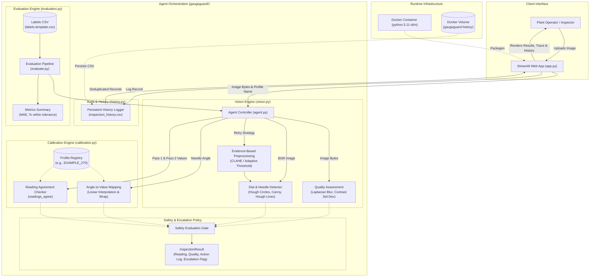
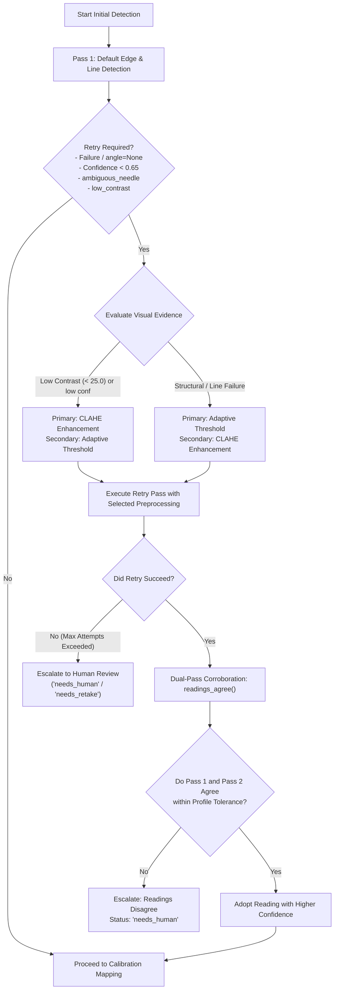

# GaugeGuard Agent: Technical Report
## A Self-Verifying Agentic Computer Vision System for Industrial Analog Gauge Monitoring

---

## Executive Summary

| Attribute | Specification |
| :--- | :--- |
| **Project Name** | GaugeGuard Agent |
| **System Classification** | Automated Optical Inspection / Agentic Computer Vision Prototype |
| **Core Runtime** | Python 3.11.9, OpenCV 5 Headless (`5.0.0.93`), NumPy 2.x, Streamlit 1.x |
| **Vision Methodology** | Classical Deterministic Geometry (Hough Circles, Canny Edges, Hough Lines, Vector Clustering) |
| **Safety Posture** | Quality-gated ingestion, dual-pass corroboration, provisional reading designation, mandatory human escalation for unverified profiles |
| **Current Calibration Status** | **Unverified Demonstration Profile (`EXAMPLE_270`)** with placeholder unit (`"units"`) |
| **Evaluation Dataset Status** | **Absence of Real Labeled Dataset** (Framework & templates created; no real images or verified readings in repo) |
| **Automated Test Coverage** | **142 Passing Tests** (0 failures, 0 skips) across agent, calibration, vision, history, and evaluation |

---

## 1. Abstract and Introduction

### 1.1 Abstract
Industrial analog dial gauges—used ubiquitously to monitor pressure, temperature, flow, and vacuum—operate purely mechanically without external electrical connections. Consequently, digitizing analog gauge readings has traditionally relied on labor-intensive human operator walk-arounds or fragile computer vision pipelines. Traditional automated vision and end-to-end deep learning models frequently suffer from "silent failures," confidently producing erroneous numbers when confronted with motion blur, poor lighting, optical glare, or oblique viewing angles.

**GaugeGuard Agent** resolves this limitation by introducing an **evidence-driven, self-verifying agentic vision system**. Rather than relying on black-box neural networks or brittle single-pass heuristics, GaugeGuard implements a deterministic inspection loop:
1. It performs pre-flight image quality screening (measuring blur variance, contrast deviation, and resolution).
2. It detects the dial rim and extracts needle vector geometry using classical OpenCV 5 algorithms.
3. If visual evidence indicates low contrast or detection ambiguity, it automatically executes targeted image enhancement (CLAHE or Gaussian adaptive thresholding).
4. It checks multi-pass reading corroboration against physical profile tolerances.
5. It gates all readings against strict calibration profiles, enforcing human escalation whenever an unverified demonstration profile (such as `EXAMPLE_270`) or an out-of-bounds condition is encountered.
6. It logs an immutable step-by-step diagnostic audit trail to both the user interface and persistent CSV storage.

### 1.2 Introduction and Background
Analog mechanical gauges remain the first line of defense in chemical refineries, manufacturing plants, offshore drilling platforms, and utility substations. Their mechanical autonomy makes them immune to electrical outages and cyber-physical network compromises. However, reading them requires manual inspection, exposing technicians to hazardous environments (high pressure, toxic gases, extreme heat) and introducing human transcription latency and fatigue errors.

Automating analog dial reading via computer vision requires solving significant optical challenges:
- **Specular Glare:** Transparent dial glass reflects plant lighting, obscuring tick marks or breaking needle edge continuity.
- **Viewing Angle Distortions:** Dial cameras often view gauges obliquely, turning circular rims into ellipses.
- **Dial Artifacts:** Pointer counterweights, manufacturer logos, mounting screws, and multiple dial scales confuse standard line detectors.

GaugeGuard Agent was developed to bridge the gap between automated inspection and industrial safety. Its core premise is that **an automated vision system must know when it is uncertain** and possess transparent mechanisms to re-evaluate evidence, cross-verify readings, and escalate unresolvable cases to human operators.

---

## 2. Problem Statement and Objectives

### 2.1 Problem Statement
The operational challenge of industrial gauge monitoring encompasses four critical failure modes:
1. **Manual Labor Costs and Safety Risks:** Periodic walk-around inspections require substantial technician hours in physically demanding or hazardous plant zones.
2. **Silent Vision Failures:** Standard edge-detection or black-box deep learning pipelines produce point estimates without uncertainty gating. When an algorithm misinterprets a shadow or a counterweight tail as the needle pointer, it silently reports a false reading that automated process controls accept.
3. **Mismatched Calibration Profiles:** Converting a needle angle into an engineering measurement (e.g., bar, PSI, kPa) requires precise physical knowledge of the dial's scale range, angular sweep, and linearity. Blindly applying a placeholder or unverified calibration profile produces misleading physical numbers.
4. **Lack of Auditability:** Industrial compliance mandates transparent operational traceability. Black-box inference provides no explainable reasoning, preventing engineers from understanding why an inspection succeeded or failed.

### 2.2 Project Objectives
The engineering objectives of the GaugeGuard Agent project are:
- **Deterministic Geometric Vision:** Implement explainable, mathematically verifiable dial rim localization and needle vector estimation using OpenCV 5 geometric primitives.
- **Pre-Flight Quality Screening:** Quantify input image sharpness (Laplacian variance), contrast (grayscale standard deviation), and resolution prior to processing.
- **Evidence-Driven Secondary Processing:** Automatically initiate targeted retries (CLAHE local contrast equalization or Gaussian adaptive binary thresholding) conditioned on explicit first-pass quality signals.
- **Multi-Pass Reading Corroboration:** Quantitatively cross-verify readings across retry passes using profile-defined agreement tolerances before accepting an angle.
- **Safety-First Calibration Gating:** Convert needle angles into calibrated engineering units while enforcing scale bounds, safe operating limits, and mandatory human review for demonstration or unverified profiles.
- **Immutable Diagnostic Tracing:** Emit a structured execution trace (`AgentStep`) recording every tool, parameter, quality flag, and decision rationale.
- **Persistent Inspection Auditing:** Record all completed inspections to persistent CSV storage with in-memory rerun deduplication for Streamlit.
- **Rigorous Verification:** Validate the entire system against an extensive automated test suite covering geometry, calibration boundaries, safety gates, and audit persistence.

---

## 3. System Architecture and Workflow

### 3.1 Architectural Decomposition
The GaugeGuard Agent repository is organized into distinct, decoupled subsystems:



### 3.2 End-to-End Operational Workflow
The inspection process executes along a deterministic multi-stage decision pipeline:

```
[Uploaded Image Bytes]
          │
          ▼
┌───────────────────────────┐
│ 1. Pre-Flight Quality     │ ──► Compute Laplacian variance, contrast std dev, dimensions.
│    Assessment             │     Flags: 'possible_blur', 'low_contrast', 'low_resolution'.
└───────────────────────────┘
          │
          ▼
┌───────────────────────────┐
│ 2. First-Pass Detection   │ ──► cv2.HoughCircles (dial rim) + cv2.HoughLinesP (needle lines).
│    (Default Processing)   │     Extract angle, confidence score, and quality flags.
└───────────────────────────┘
          │
          ├─────────────────────────────────────────────────┐
          │ (Confident detection, confidence >= 0.65,       │ (Uncertain: confidence < 0.65,
          │  no ambiguous needle, good contrast)            │  ambiguous needle, or low contrast)
          │                                                 ▼
          │                                 ┌───────────────────────────────┐
          │                                 │ 3. Evidence-Driven Retry Loop │
          │                                 │    - Low contrast -> CLAHE    │
          │                                 │    - Shape fail -> Adaptive   │
          │                                 └───────────────────────────────┘
          │                                                 │
          │                                                 ▼
          │                                 ┌───────────────────────────────┐
          │                                 │ 4. Dual-Pass Corroboration    │
          │                                 │    Compare initial vs retry   │
          │                                 └───────────────────────────────┘
          │                                                 │
          │                                ┌────────────────┴────────────────┐
          │                                │ Disagree (> tolerance)          │ Agree (<= tolerance)
          │                                ▼                                 ▼
          │                   [Escalate to Human Review]          [Select Higher Confidence]
          │                                │                                 │
          └────────────────────────────────┼─────────────────────────────────┘
                                           ▼
                       ┌────────────────────────────────────────┐
                       │ 5. Calibration Mapping                 │
                       │    Map needle angle theta to value     │
                       │    Enforce scale sweep & boundaries    │
                       └────────────────────────────────────────┘
                                           │
                                           ▼
                       ┌────────────────────────────────────────┐
                       │ 6. Safety Policy Gating                │
                       │    - Unverified Demo Profile?          │ ──► 'needs_human' (Provisional)
                       │    - Out of Operating Limits?          │ ──► 'needs_human' (Provisional)
                       │    - Active Vision/Quality Flags?      │ ──► 'needs_human' (Provisional)
                       │    - All Checks Clear & Verified?      │ ──► 'accepted'
                       └────────────────────────────────────────┘
                                           │
                                           ▼
                       ┌────────────────────────────────────────┐
                       │ 7. Audit Logging & UI Presentation     │
                       │    - Populate AgentStep action log     │
                       │    - Append to inspection_history.csv  │
                       │    - Render annotated overlay & trace  │
                       └────────────────────────────────────────┘
```

---

## 4. Technologies Used

GaugeGuard Agent is engineered with a strict, auditable dependency tree. All libraries are explicitly declared in `requirements.txt` and `requirements-dev.txt`:

| Technology / Component | Pinned Version / Constraint | Architectural Role | Technical Justification |
| :--- | :--- | :--- | :--- |
| **Python** | `3.11.9` (3.11+ compatible) | Core Application Language | Clean typing support, dataclasses, exception chaining, high performance. |
| **OpenCV (Headless)** | `opencv-python-headless==5.0.0.93` | Computer Vision Processing | Target OpenCV 5 API; headless distribution avoids unnecessary X11/GUI runtime bloat; provides optimized Canny, Hough, and histogram implementations. |
| **NumPy** | `numpy>=2.0,<3` | Numerical Matrix Math | Fast array operations for image buffers, vector normalization, and trigonometric clustering. |
| **Streamlit** | `streamlit>=1.60,<2` | Web User Interface | Lightweight reactive Python UI framework; enables instant parameter adjustment, visual inspection, and diagnostic exploration without separate frontend build chains. |
| **pytest** | `pytest>=8.0` | Test Automation | Industry standard Python testing framework for parameterized regression suites and fixtures. |
| **Docker** | Base `python:3.11-slim` | Container Deployment | Ensures deterministic, reproducible deployment; isolates dependencies; packages system libraries (`libglib2.0-0`, `libgomp1`). |

### Deterministic Vision vs. Neural Networks
GaugeGuard explicitly uses **classical, deterministic computer vision** (Hough transforms, spatial edge detection, histogram equalization, adaptive thresholding) rather than deep learning or generative vision-language models. 
- Every detected line corresponds to an analytical equation $(x, y) \to (\rho, \theta)$.
- The system never "hallucinates" numbers or dial features.
- Failure modes produce traceable geometric signals (e.g., zero lines detected, high dispersion, low confidence) rather than silent false predictions.

---

## 5. Vision Processing and Calibration

### 5.1 Image Ingestion and Quality Assessment
The vision pipeline begins with `decode_image()` and `inspect_image_quality()` in `gaugeguard/vision.py`:
1. **Decoding:** Validates non-empty byte buffers and decodes raw bytes into a BGR NumPy array via `cv2.imdecode()`.
2. **Sharpness / Blur Variance:** Computes the variance of the Laplacian operator on the grayscale image:
   $$\text{Blur Score} = \text{Var}(\nabla^2 I)$$
   If $\text{Blur Score} < 45.0$, the image is flagged with `possible_blur`.
3. **Contrast Score:** Computes the standard deviation of grayscale pixel intensities:
   $$\text{Contrast Score} = \sqrt{\frac{1}{N}\sum_{i=1}^N (I_i - \mu_I)^2}$$
   If $\text{Contrast Score} < 18.0$, the image is flagged with `low_contrast`.
4. **Resolution Check:** If $\min(\text{width}, \text{height}) < 160\text{ px}$, the image is flagged with `low_resolution`.

### 5.2 Dial Rim Localization
Dial outer boundary localization is performed using the Circle Hough Transform:
1. Grayscale conversion followed by $5 \times 5$ Gaussian blur (`cv2.GaussianBlur`) to suppress high-frequency noise.
2. Dial circle search using `cv2.HoughCircles` (`HOUGH_GRADIENT` method) with dynamic radius limits ($r_{\min} = 0.25 \times \text{dim}_{\min}$, $r_{\max} = 0.50 \times \text{dim}_{\min}$).
3. **Fallback Mechanism:** If no circular rim meets the accumulator threshold, the system adopts a centered circular region-of-interest assumption ($x_c = W/2, y_c = H/2, r = 0.42 \times \min(W, H)$) and assigns a lower baseline confidence score.

### 5.3 Needle Detection and Vector Clustering
Needle localization utilizes the Probabilistic Hough Line Transform within the dial ROI:
1. An annular or circular mask isolates the interior dial face.
2. Canny edge detection extracts strong boundary gradients.
3. `cv2.HoughLinesP` detects candidate line segments.
4. **Radial Length and Angle Weighting:** Detected line segments are evaluated relative to the dial center $(x_0, y_0)$. Lines directed radially outward are converted to directional unit vectors:
   $$\vec{u} = (\cos \theta, \sin \theta)$$
5. **Collinear Counterweight Tail Disambiguation:** Physical industrial gauges typically feature needle pointers with short, wide counterweights extending directly opposite the tip. Lines oriented at $180^\circ \pm 25^\circ$ from the dominant candidate vector are categorized as counterweight tails and suppressed.
6. **Ambiguity Gating:** If two distinct non-collinear line clusters exhibit comparable voting weights (competing pointers), the detection flags `ambiguous_needle`, caps confidence at $0.20$, and aborts single-angle resolution to force human verification.

### 5.4 Needle Angle Convention
- Needle angles are defined in degrees within the range $[0.0, 360.0)$.
- **Orientation Reference:**
  - $0^\circ$ corresponds to 12 o'clock (straight up, $-Y$ in image pixel space).
  - $90^\circ$ corresponds to 3 o'clock (horizontal right, $+X$).
  - $180^\circ$ corresponds to 6 o'clock (straight down, $+Y$).
  - $270^\circ$ corresponds to 9 o'clock (horizontal left, $-X$).
- Sweeps proceed **clockwise (CW)**.

### 5.5 Calibration Engine and Linear Interpolation
Gauge calibration is defined by immutable `GaugeProfile` instances in `gaugeguard/calibration.py`:
- `name`: Profile identifier (e.g., `EXAMPLE_270`).
- `unit`: Physical unit of measurement (e.g., `PSI`, `bar`, `kPa`, or placeholder `"units"`).
- `minimum_value`, `maximum_value`: Scale start and end engineering values.
- `minimum_angle_degrees`, `maximum_angle_degrees`: Angular start and end positions.
- `bounds_margin_deg`: Endpoint buffer (default $5.0^\circ$) to flag needles resting at mechanical stops.
- `operating_min`, `operating_max`: Normal operating boundaries.
- `agreement_tolerance_fraction`: Tolerance fraction for multi-pass retry agreement (default $0.02$, or $2\%$).
- `eval_tolerance_fraction`: Acceptance tolerance fraction for evaluation (default $0.05$, or $5\%$).

The linear conversion formula maps measured angle $\theta$ to engineering value $V$:
$$\text{Sweep} = (\theta_{\max} - \theta_{\min}) \pmod{360^\circ}$$
$$\text{Offset} = (\theta - \theta_{\min}) \pmod{360^\circ}$$
$$\text{Value} = V_{\min} + \left(\frac{\text{Offset}}{\text{Sweep}}\right) \times (V_{\max} - V_{\min})$$

### 5.6 Unverified Calibration Status
> [!IMPORTANT]
> **UNVERIFIED DEMONSTRATION CALIBRATION IDENTIFICATION:**
> The repository's currently registered profile is **`EXAMPLE_270`**:
> - It specifies a $270^\circ$ clockwise sweep from $225^\circ$ (7:30 position) to $135^\circ$ (4:30 position) with scale range $[0.0, 100.0]$.
> - It uses the placeholder unit **`"units"`**.
> - It is **not calibrated to any physical gauge model**.
> 
> In accordance with safety policies, `gaugeguard/agent.py` contains `_is_unverified_demo_profile()`. Any inspection executed under `EXAMPLE_270` is automatically tagged with the flag `unverified_demo_profile` and **strictly blocked from achieving `accepted` status**, enforcing human escalation on every run.

---

## 6. Agent Retry Logic and Safety Mechanisms

### 6.1 The Agentic Retry Loop
Unlike static computer vision pipelines, GaugeGuard implements an active agentic retry loop orchestrated by `inspect_upload()` in `gaugeguard/agent.py`:



1. **Targeted Method Selection:**
   - **CLAHE (Contrast Limited Adaptive Histogram Equalization):** Selected when the image exhibits poor contrast ($\text{score} < 25.0$ or flag `low_contrast`), equalizing local histograms to expose needle edges under dim or uneven lighting.
   - **Gaussian Adaptive Binary Thresholding:** Selected when dial geometry fails to segment under global Canny thresholds, calculating dynamic pixel-by-pixel thresholds over local neighborhoods.
2. **Dual-Pass Corroboration (`readings_agree`):**
   When both the initial pass and retry pass yield angle detections, they are converted to readings and compared:
   $$\text{Difference} = |V_1 - V_2|$$
   $$\text{Tolerance} = \text{agreement\_tolerance\_fraction} \times (V_{\max} - V_{\min})$$
   If $\text{Difference} > \text{Tolerance}$, the agent determines that optical ambiguity cannot be resolved automatically, logs the discrepancy, and immediately escalates to human review.

### 6.2 Safety Escalation Policies
GaugeGuard enforces zero-tolerance safety policies:
- **Mandatory Human Review Conditions:**
  - Active profile is an unverified demonstration profile (`EXAMPLE_270`).
  - Needle direction is ambiguous (`ambiguous_needle`).
  - Confidence score falls below $0.60$.
  - Calculated value lies outside the calibrated scale sweep (`out_of_bounds`).
  - Calculated value exceeds safe operating thresholds (`outside_operating_limits`).
  - Calculated value rests within endpoint bounds margins (`at_scale_min`, `at_scale_max`).
  - Retried detections disagree beyond the agreement tolerance.
  - Image quality screening flags blur or severe contrast degradation.
- **Provisional Reading Designation:**
  When human review is triggered, calculated readings are **not discarded**. Instead, they are preserved in `InspectionResult.reading.value` and explicitly labeled as **Provisional**. This allows human technicians to review the algorithm's mathematical hypothesis alongside the visual overlay without presenting the reading as certified.

### 6.3 Diagnostic Action Logging
Every inspection constructs an auditable trail of `AgentStep` records:
- `step_name`: Formal phase identifier (`quality_check`, `initial_detection`, `retry_clahe`, `reading_comparison`, `calibration_mapping`, `final_decision`).
- `method`: Specific algorithm invoked (e.g., `opencv_laplacian_and_contrast`, `linear_angle_to_value`, `quality_gated_acceptance`).
- `reason`: Plain-English explanation justifying why the tool was selected or why a decision was reached.
- `output_summary`: Structured JSON dictionary capturing numerical intermediate outputs, dial center coordinates, confidence scores, and raised flags.

---

## 7. Inspection History and Evaluation Metrics

### 7.1 Persistent Inspection History
The history subsystem (`gaugeguard/history.py`) maintains an auditable record of all inspections:
- **Storage File:** `inspection_history.csv` located in `GAUGEGUARD_HISTORY_DIR` (or local repo root by default).
- **Audit Schema:**
  `timestamp`, `filename`, `calibration_profile`, `estimated_reading`, `unit`, `angle_degrees`, `inspection_status`, `needs_human_review`, `retry_count`, `reason`.
- **Rerun Deduplication:** Streamlit re-executes Python scripts on every widget interaction. The history manager tracks in-memory fingerprints of recent writes to prevent duplicate rows from being appended during interface reruns.
- **CSV Download:** An interactive download button allows plant supervisors to export the complete inspection audit log directly from the UI.
- **Docker Persistence:** Under containerized deployment, the directory is mounted to a named Docker volume (`gaugeguard-history:/app/history-data`), ensuring persistence across container updates and restarts.

### 7.2 Evaluation Metrics Framework
The evaluation module (`gaugeguard/evaluation.py` and `evaluate.py`) computes standardized performance metrics when labeled reference data is supplied:
1. **Mean Absolute Error (MAE):**
   $$\text{MAE}_{\text{accepted}} = \frac{1}{|S_{\text{accepted}}|} \sum_{i \in S_{\text{accepted}}} |v_{\text{pred}, i} - v_{\text{ref}, i}|$$
2. **Share within Configurable Tolerance:**
   $$\text{Share}_{\le \tau} = \frac{|\{i \in S_{\text{accepted}} : |v_{\text{pred}, i} - v_{\text{ref}, i}| \le \tau\}|}{|S_{\text{accepted}}|} \times 100\%$$
   Configurable via `--tolerance <value>` (absolute units) or `--tolerance-fraction <fraction>` (e.g., 5% of scale).
3. **Incorrect-Acceptance Rate:**
   Measures hazardous false acceptances (where error exceeds tolerance or human acceptable was labeled false):
   $$\text{Rate}_{\text{inc/acc}} = \frac{N_{\text{incorrect accepted}}}{N_{\text{accepted}}} \times 100\% \quad (\text{Denominator: Accepted Readings})$$
   $$\text{Rate}_{\text{inc/total}} = \frac{N_{\text{incorrect accepted}}}{N_{\text{total valid}}} \times 100\% \quad (\text{Denominator: Total Valid Samples})$$
4. **Operational Escalation and Retry Rates:**
   $$\text{Rate}_{\text{escalation}} = \frac{N_{\text{escalated}}}{N_{\text{total valid}}} \times 100\%, \quad \text{Rate}_{\text{retry}} = \frac{N_{\text{retried}}}{N_{\text{total valid}}} \times 100\%$$

### 7.3 Absence of Real Labeled Evaluation Dataset
> [!IMPORTANT]
> **EVALUATION DATASET DISCLOSURE:**
> Direct inspection of the repository confirms that **no real gauge images with verified reference readings are currently available** in `data/samples/`.
> 
> To maintain strict scientific and engineering integrity:
> - **No accuracy percentages, MAE numbers, or benchmark figures have been invented or claimed.**
> - Standardized label templates ([`data/samples/labels.template.csv`](file:///c:/Users/kulka/OneDrive/Desktop/Gauge/GaugeGuard-Agent/data/samples/labels.template.csv) and [`data/samples/labels.csv`](file:///c:/Users/kulka/OneDrive/Desktop/Gauge/GaugeGuard-Agent/data/samples/labels.csv)) are provided.
> - When executed against the template, `evaluate.py` cleanly reports that zero labeled samples are present and exits gracefully without error.
> - The evaluation pipeline stands fully implemented and verified via unit tests, ready to process real images as soon as they are captured with proper license and owner consent.

---

## 8. Testing Results

The GaugeGuard Agent repository contains an automated regression and unit test suite comprising **142 tests** using `pytest`. All 142 tests pass with zero failures.

```text
============================= test session starts =============================
platform win32 -- Python 3.14.3, pytest-9.1.1, pluggy-1.7.0
rootdir: C:\Users\kulka\OneDrive\Desktop\Gauge\GaugeGuard-Agent
plugins: anyio-4.13.0
collected 142 items

tests\test_agent.py ..................                                   [ 12%]
tests\test_calibration.py .............................................. [ 45%]
.......................................                                  [ 72%]
tests\test_evaluation.py ..........                                      [ 79%]
tests\test_history.py ................                                   [ 90%]
tests\test_vision.py .............                                       [100%]

============================= 142 passed in 4.10s =============================
```

### Test Suite Breakdown

| Test Module | Test Count | Scope of Verification | Key Invariants Tested |
| :--- | :---: | :--- | :--- |
| **`tests/test_agent.py`** | 18 | Agent Orchestration & Safety | End-to-end inspection flow; empty byte rejection; retry trigger on low contrast/confidence; dual-pass agreement comparisons; action log completeness; mandatory escalation on unverified demo profile (`EXAMPLE_270`). |
| **`tests/test_calibration.py`** | 85 | Calibration Math & Boundaries | Angle normalization in $[0, 360)$; clockwise sweep calculation with 12 o'clock wrap-around; linear mapping accuracy; operating range bounds; endpoint margin alerts; profile registry consistency; agreement tolerance math. |
| **`tests/test_evaluation.py`** | 10 | Evaluation Pipeline & CLI | MAE calculation on scalar vectors; configurable tolerance boundary conditions; CSV parsing with comments and whitespace; graceful handling of empty templates; mocked end-to-end dataset evaluation; CLI execution and JSON output formatting. |
| **`tests/test_history.py`** | 16 | History Persistence & Audit | CSV schema compliance; row append logic; header preservation; in-memory deduplication during reactive reruns; `GAUGEGUARD_HISTORY_DIR` environment path resolution; corrupted file recovery. |
| **`tests/test_vision.py`** | 13 | Geometric Vision & Hough Logic | Hough circle dial localization; cardinal needle orientations ($0^\circ, 90^\circ, 180^\circ, 270^\circ$); blank image rejection; counterweight tail suppression ($180^\circ \pm 25^\circ$); non-collinear needle ambiguity detection; real industrial gauge fixture angle accuracy ($45.2^\circ \pm 2.0^\circ$). |
| **Total** | **142** | **100% Pass Rate** | Zero failures, zero regressions across all core components. |

---

## 9. Limitations and Future Scope

### 9.1 Known Limitations
1. **Parallax and Oblique Viewing Angles:** The circle Hough transform assumes the camera optical axis is perpendicular to the dial plane. Oblique angles induce elliptical projection distortion, which can degrade circle and line localization.
2. **Linear Scale Assumption:** The current calibration engine strictly assumes a linear distribution between needle angle and measured value. Non-linear gauges (e.g., square-root flow gauges, logarithmic vacuum gauges) are not currently supported.
3. **Severe Optical Obstructions:** Heavy specular reflections, shattered dial glass, or dense physical obstructions spanning the dial pivot point cannot be resolved and trigger escalation to human inspection.
4. **Single-Gauge per Frame:** The vision pipeline is designed to localize a single prominent circular dial per uploaded image. Wide-angle facility scenes containing multiple dials require cropping prior to inspection.
5. **Absence of Real Empirical Benchmark:** Because no real labeled evaluation dataset is currently checked into the repository, real-world field accuracy across environmental variations has not been quantified.

### 9.2 Future Scope
1. **OCR-Assisted Auto-Calibration:** Integrate an optical character recognition engine (such as Tesseract or a lightweight text detector) to read printed dial numerals ($0, 10, 20, \dots$) and engineering units directly from the dial face, automatically synthesizing `GaugeProfile` definitions.
2. **Elliptical Dial Homography Rectification:** Implement direct ellipse fitting and inverse perspective homography transformations to unwarp angled gauge photos into frontal circular views.
3. **Decoupled RESTful API (FastAPI):** Separate the inspection agent into a headless HTTP/REST microservice to allow automated drone fleets, fixed inspection cameras, or IoT gateways to trigger inspections programmatically.
4. **Temporal Video Kalman Filtering:** Support RTSP video streaming from stationary monitoring cameras, applying a temporal Kalman filter across consecutive needle angles to filter transient lighting changes or sensor noise.
5. **AWS Cloud Architecture:** Complete the planned deployment pipeline onto AWS EC2 with IAM-controlled Amazon S3 bucket storage for securely archiving consented inspection images.

---

## 10. Conclusion and References

### 10.1 Conclusion
GaugeGuard Agent demonstrates an engineering approach to automated industrial gauge inspection. By prioritizing explainability, deterministic geometric algorithms, and safety-first agentic orchestration, the system addresses the risks associated with silent vision failures. 

Through pre-flight quality checks, evidence-driven retry passes, multi-pass agreement corroboration, and strict calibration gating, GaugeGuard preserves plant safety by escalating uncertain or unverified inspections to human technicians. The codebase is supported by a comprehensive 142-test automated test suite, containerized packaging, persistent audit logging, and an evaluation framework ready for empirical dataset assembly.

### 10.2 References and Standards Grounding
1. **OpenCV Documentation:** OpenCV 5 (`opencv-python-headless==5.0.0.93`), Open Source Computer Vision Library, [https://opencv.org/](https://opencv.org/).
2. **Circle Hough Transform:** Duda, R. O., & Hart, P. E. (1972). *Use of the Hough Transformation to Detect Lines and Curves in Pictures*. Communications of the ACM, 15(1), 11-15.
3. **Canny Edge Detection:** Canny, J. (1986). *A Computational Approach to Edge Detection*. IEEE Transactions on Pattern Analysis and Machine Intelligence, 8(6), 679-698.
4. **Contrast Limited Adaptive Histogram Equalization (CLAHE):** Zuiderveld, K. (1994). *Contrast Limited Adaptive Histogram Equalization*. Graphics Gems IV, Academic Press, 474-485.
5. **Laplacian Blur Metric:** Pech-Pacheco, J. L., et al. (2000). *Diatom Autofocusing in Brightfield Microscopy: a Comparative Study*. Proceedings 15th International Conference on Pattern Recognition.
6. **Streamlit Framework:** Streamlit, The fastest way to build and share data apps, [https://streamlit.io/](https://streamlit.io/).
7. **Repository Documentation and Architecture:**
   - [`README.md`](file:///c:/Users/kulka/OneDrive/Desktop/Gauge/GaugeGuard-Agent/README.md): System documentation, Docker execution, and workflow specifications.
   - [`CONTRACTS_DRAFT.md`](file:///c:/Users/kulka/OneDrive/Desktop/Gauge/GaugeGuard-Agent/CONTRACTS_DRAFT.md): Architectural interface contracts and error handling specifications.
   - [`docs/architecture.mmd`](file:///c:/Users/kulka/OneDrive/Desktop/Gauge/GaugeGuard-Agent/docs/architecture.mmd): System architecture flow diagram.
   - [`docs/evaluation-plan.md`](file:///c:/Users/kulka/OneDrive/Desktop/Gauge/GaugeGuard-Agent/docs/evaluation-plan.md): Technical evaluation methodology, metric definitions, and CLI execution instructions.
